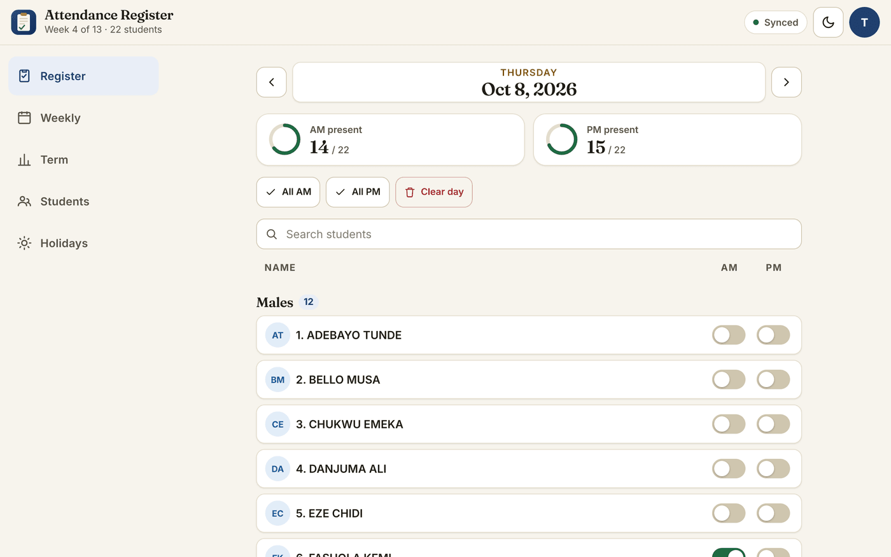
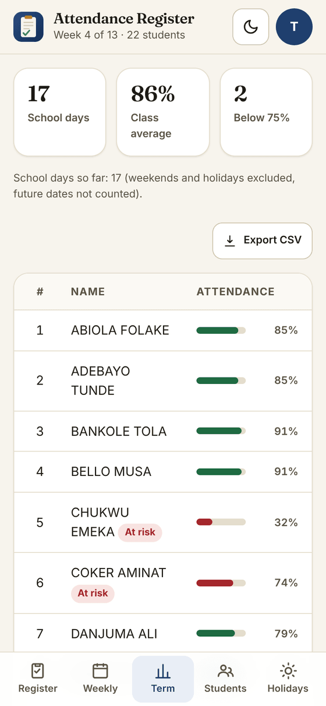

<div align="center">


# Attendance Register

**A private daily AM/PM attendance register for teachers, with weekly and term reports that sync live and work offline.**

[](https://github.com/babatundeawo/attendance/actions/workflows/deploy.yml)
[](https://github.com/babatundeawo/attendance/actions/workflows/codeql.yml)

[Live site](https://babatundeawo.github.io/attendance/) · [Documentation](docs/) · [Report an issue](https://github.com/babatundeawo/attendance/issues)

</div>

<p align="center">
  
</p>

## About

Attendance Register replaces the paper register for a class. A teacher marks each student present for the morning and afternoon sessions, and the app turns those marks into weekly and term reports. Records are stored in Firebase so several teachers see the same data, and the app keeps working without internet, syncing when the connection returns.

## Features

- Mark AM and PM attendance per student with one tap, plus "All AM", "All PM" and "Clear day"
- Live AM and PM present counts for the selected day
- Weekly report with day totals and per-student points
- Term report with class average, "At risk" and perfect-attendance flags
- Student records: admission number, date of birth, parent or guardian, address, phone, religion
- Holiday calendar that excludes days from reports
- CSV export of the weekly report, term report and student list
- Print-friendly reports
- Email and password sign-in, limited to approved staff
- Works offline; installable on phones and desktops
- Light and dark themes

## How to use it

1. Open the [live site](https://babatundeawo.github.io/attendance/) and sign in with the email and password your administrator gave you.
2. **Register**: pick a date, then switch AM and PM on for each student who is present.
3. **Weekly** and **Term**: review attendance, and use **Export CSV** to download a report.
4. **Students**: add or edit a student by filling in the form, or tap a student's name to edit it.
5. **Holidays**: add dates that are not school days.
6. To install the app on a phone, use your browser's **Add to Home screen** option.

<p align="center">
  
</p>

## Tech stack

- Vanilla JavaScript (ES modules), built with [Vite](https://vite.dev)
- [Firebase](https://firebase.google.com): Authentication and Cloud Firestore
- [Fraunces](https://fonts.google.com/specimen/Fraunces) and [Inter](https://rsms.me/inter/) fonts, self-hosted
- Service worker for offline use
- GitHub Actions and GitHub Pages for building and hosting

## Project structure

```text
.
├── index.html            App shell
├── src/
│   ├── main.js           Start-up, navigation, routing between screens
│   ├── config.js         Term dates and report settings
│   ├── logic.js          Date, attendance and report calculations
│   ├── data.js           Firestore subscriptions and writes
│   ├── auth.js           Sign-in helpers
│   ├── views/            One file per screen
│   └── styles/           Design tokens, base and component styles
├── public/               Icons, manifest, service worker, social image
├── tests/                Automated tests
├── docs/                 Guides for deployment, customizing and login setup
├── firestore.rules       Database security rules
└── .github/              Build, deploy and security workflows
```

## Contributing

Found a bug or have an idea? [Open an issue](https://github.com/babatundeawo/attendance/issues/new). To propose a change, edit a file on GitHub, choose **Create a new branch and start a pull request**, and wait for the checks on the pull request to turn green.

## Security

Please report vulnerabilities privately; see [SECURITY.md](SECURITY.md).

## Credits

- Fonts: Fraunces and Inter, both under the [SIL Open Font License 1.1](https://openfontlicense.org), via [Fontsource](https://fontsource.org).
- Icons are drawn for this project.
- Sample names in the screenshots are made up.
